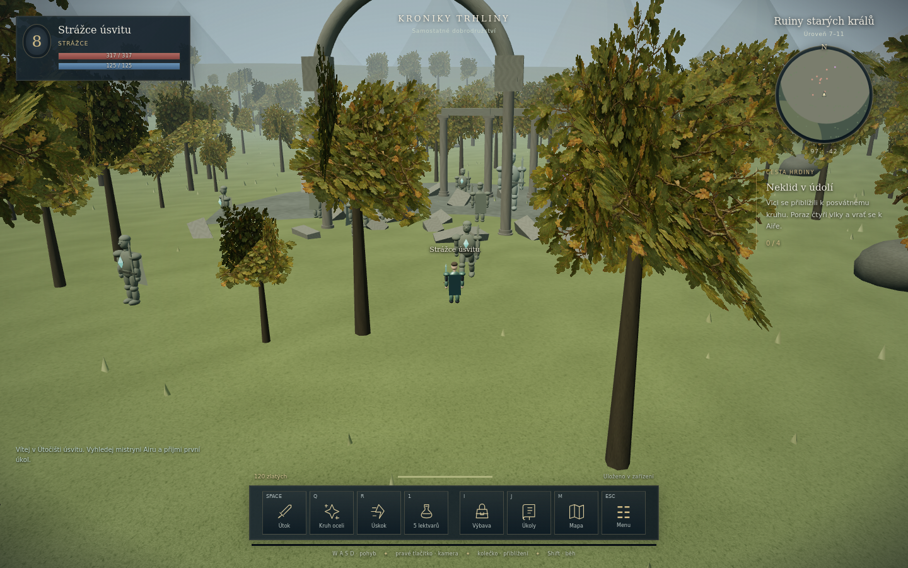

# Life Is Bitch · Kroniky trhliny

Hratelný základ otevřeného fantasy RPG. Město, domy, auta, dopravu a městské aktivity nahrazuje souvislá 3D krajina: útočiště, údolí, les, staré ruiny, zasněžené vrchy a oblast s bossem. Herní směr vychází z Metinu 2; grafický směr z klasického fantasy Lineage II: lidské proporce, kovová zbroj, pláště, přírodní barvy a monumentální kamenné brány. Modely jsou vlastní procedurální základ, nepoužívají soubory těchto her.

Tato verze je **online RPG prototyp**, nikoli hotové produkční MMORPG. Obsahuje skutečné společné hraní přes autoritativní server, ale ještě nemá rozsáhlou produkční infrastrukturu, cechy, obchodování mezi hráči, PvP, profesionální modely ani animace z motion capture. Kapacita tisíců hráčů není ověřená.



Snímek skutečného rendereru z vizuálního testu: samostatná testovací postava na úrovni 8, standardní grafika se stíny. Výtvarné podklady a finální prompt vlastní textury vytvořené vestavěným imagegen jsou v [web/assets/README.md](web/assets/README.md); samotná textura je `web/assets/oak-foliage.png`.

## Rychlé spuštění ve Windows

Nainstaluj Node.js 24 nebo novější. V PowerShellu ve složce projektu:

```powershell
git switch feat/fantasy-open-world
npm ci --omit=dev
npm start
```

Otevři **http://127.0.0.1:8790**. Vyber jméno a povolání, pak samostatné dobrodružství nebo online svět. Server spouštěj z kořene projektu. Běží, dokud nezavřeš terminál (Ctrl+C jej bezpečně ukončí).

- **Samostatné dobrodružství** běží v zařízení a ukládá se průběžně do IndexedDB. Nepotřebuje připojení k hernímu serveru, pokud jsou soubory hry již lokálně dostupné v desktopové/Android aplikaci. Webovou verzi nejdříve musí doručit HTTP server. Offline svět se při návratu znovu zalidní nepřáteli, postava a úkoly zůstávají.
- **Online svět** sdílí nepřátele a ostatní hráče na stejné adrese serveru. Postava se ukládá na serveru do SQLite. Prohlížeč si uloží náhodný klíč pro návrat; bez něj online postavu neobnoví. Offline statistiky se na server nepřenášejí. Nejde o přihlášení ke starým městským účtům.
- Smazání dat prohlížeče odstraní offline postup a klíče online postav. Novou offline postavu vytváří samostatné tlačítko s potvrzením.

## Co lze hrát

Strážce bojuje mečem a kruhovým úderem, lovec lukem a zpomalujícím šípem, mystik runovou holí a plošnou magií. Postava získává XP, úrovně, zlato a vybavení. Vlci, kanci, pavouci, kamenní strážci, vlčí duchové, kameny trhliny a Varkh mají společný stav na online serveru. Nepřátelé vyhledávají cíle, pronásledují je, vracejí se domů a obnovují se. Při společném boji získávají odměnu přispívající hráči v okolí.

Začni u **mistryně Airy** v útočišti. Má tři navazující úkoly. **Ren** prodává lektvary a vykupuje nenasazené předměty. **Nami** obnovuje zdraví a manu. V bezpečí útočiště se zdraví postupně léčí. Smrt znamená návrat po pěti sekundách a ztrátu 5 % zlata.

| Ovládání | Akce |
| --- | --- |
| WASD / šipky | Pohyb podle natočení kamery |
| Shift | Běh se spotřebou výdrže |
| Levé kliknutí | Cesta po zemi / výběr a automatický útok na nepřítele |
| Pravé tažení / kolečko | Otáčení a výška kamery / přiblížení |
| Mezerník / první tlačítko lišty | Držený útok / přepnutí automatického útoku |
| Tab | Výběr blízkého nepřítele |
| Q / R / 1 | Schopnost / úskok / léčivý lektvar |
| E | Rozhovor v dosahu |
| I / J / M | Výbava / úkoly / mapa |
| Enter | Online chat |
| Esc | Menu; offline se hra pozastaví, online svět pokračuje |
| F11 v desktopu | Celá obrazovka |

Dotykové zařízení má směrová tlačítka, interakci a stejnou lištu schopností. Kameru můžeš přiblížit v desktopu; pro slabší zařízení je v menu úsporná grafika. Moderní WebGL 2 je nutné.

## Vlastní online server

Server bez konfigurace poslouchá pouze na `127.0.0.1:8790`. Pro hraní na stejné LAN:

```powershell
$env:HOST = "0.0.0.0"
npm start
```

Ostatní hráči otevřou `http://IP_TVEHO_PC:8790` a zvolí online svět. Firewall musí povolit příchozí TCP port 8790. Počítač musí běžet. Při internetovém hostingu použij reverzní proxy s HTTPS a WebSocket upgradem; adresa hry je pak `https://tvoje-domena` a server `wss://tvoje-domena/world`. Android a HTTPS stránka vyžadují zabezpečené spojení `wss://` k vzdálenému serveru.

| Proměnná | Výchozí stav |
| --- | --- |
| `PORT` | `8790` |
| `HOST` | `127.0.0.1` |
| `WORLD_DB` | `server/data/world.sqlite` |
| `WORLD_ORIGINS` | Volitelné přesné originy oddělené čárkou pro jinak hostovaný klient |

Server přijímá vstupy a záměry hráče, nikoli jeho pozici, HP nebo odměny. Simuluje 20 kroků/s, posílá 10 snímků/s hráčům v okolí a zastaví pohyb při zastaralém vstupu. Omezuje velikost zpráv, frekvenci, počet spojení a pomalé klienty. Klíče postav ukládá pouze jako SHA-256 hash. SQLite používá WAL; zálohuj databázi korektním SQLite backupem nebo při vypnutém serveru. Ukončení přes Ctrl+C uloží všechny připojené postavy. Kontrola dostupnosti: `/health`.

Výchozí limit 128 spojení a 8 spojení na IP je ochranný limit prototypu, ne benchmark kapacity. Pro veřejný provoz ještě doplň účty a obnovu přístupu, monitoring, správu serveru, škálování a zátěžové ověření.

## Desktop a Android

```powershell
npm ci
npm run desktop:start
npm run desktop:smoke
npm run desktop:build
npm run desktop:installer
```

Vývojové spuštění Electronu používá soubory z aktuální větve. Zabalenou hru lze spustit s `--direct`, aby použila přibalené soubory místo aktualizátoru z `main`. Běžný launcher zabalené hry stále aktualizuje z hlavní větve; proto se nová fantasy větev nasadí všem až po jejím sloučení. Stará městská uložení zůstávají oddělená.

Android: JDK 17, SDK 35, Gradle 8.9; ve složce `android` spusť `gradle :app:assembleDebug :app:bundleRelease`. Výsledek je v `android/app/build/outputs/`. Vyžaduje aktuální systémový WebView s WebGL 2; výkon na fyzickém telefonu ověř samostatně. Pro online hraní zadej adresu vlastního `wss://` serveru, ne lokální adresu webových assetů. Balíček je vývojový a není připravený pro vydání v obchodu.

## Ověření a struktura

```powershell
npm test
python backend/test_accounts.py
```

`tests/world.cjs` ověřuje pohyb, kolize, vstupy, souboj, společné odměny, úkoly, vybavení, smrt a obnovu. `tests/server.cjs` připojuje dva skutečné WebSocket klienty, ověřuje společný boj, podvržené statistiky, ochranu souborů, originy, zastaralé vstupy a obnovení postavy po restartu SQLite. Testy aktualizátoru a validace starých profilů zůstávají zachované.

Pro skutečný prohlížeč po `npm ci`: `npx playwright install chromium` a `npm run test:browser`. Test si sám spustí dočasný server a databázi, projde offline hraní, rozhovor, přijetí úkolu, inventář, mapu, souboj a obnovení, pak dva online hráče, chat, návrat postavy a dotykové rozhraní. Snímky ukládá do `test-results/`. Vlastní nainstalovaný Chromium lze zadat proměnnou `BROWSER_EXECUTABLE_PATH`. Pomalé zařízení může otevřít hru s `?quality=low`.

`npm run screenshots` pořídí náhled lesa a ruin se samostatnými testovacími postavami. Kontroluje také shader průhledu skrz listí před postavou a plné stíny. Tyto testovací postavy slouží k výtvarné kontrole a nezasahují do skutečných uložení.

- `web/world.js`: sdílená pravidla a deterministická mapa.
- `web/renderer3d.js`: Three.js scéna, kamera, modely a animace.
- `web/game.js`: ovládání, rozhraní, lokální uložení a síťový klient.
- `server/world-server.cjs`: HTTP, autoritativní WebSocket svět a SQLite.
- `desktop/`: Electron, launcher a ověřovaný aktualizátor.
- `backend/`: původní oddělený registr a účty; fantasy server je nepoužívá.

Three.js je přibalený lokálně včetně licence v `web/vendor/THREE-LICENSE.txt`. Vlastní textura listí a její původ i prompt jsou v `web/assets/`. Pro běh hry se nestahují knihovny, fonty ani herní assety z CDN.
